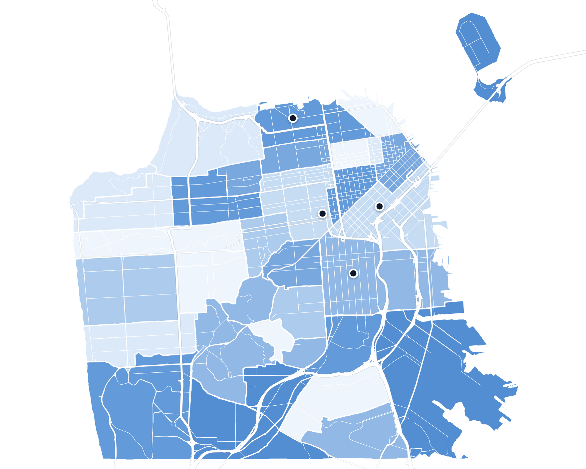

# Nope

Notion-style React component library — TypeScript, styled-components, Storybook.

## Install

```bash
npm install nope-ui
# peer deps
npm install react react-dom          # ^18.2 || ^19
npm install d3-geo                   # required by <WatercolorMap>
```

## Components

### `WatercolorMap`

A fast, dependency-light SVG "watercolor" choropleth map. Region polygons with
hashed fills + white street strokes, optional road lines, and pins for points of
interest. The component is **fully data-driven and city-agnostic** — point it at
any city's GeoJSON and it just works (the aspect correction is auto-derived from
the data).

Uses a planar `geoIdentity` projection with a `cos(lat)` aspect correction —
avoiding the winding-collapse bug `geoMercator` hits on some tract/boundary data.



```tsx
import { WatercolorMap, WATERCOLOR_PALETTES, type WatercolorMarker } from "nope-ui";
import regions from "./data/sf-neighborhoods.json"; // any GeoJSON FeatureCollection

const markers: WatercolorMarker[] = [
  { name: "Cerebral Valley", date: "2024 · Hayes Valley", lat: 37.7765, lng: -122.4256 },
  { name: "AI Tinkerers",    date: "2025 · SoMa",         lat: 37.7785, lng: -122.4056 },
];

<WatercolorMap regions={regions} markers={markers} palette={WATERCOLOR_PALETTES.green} />;
```

| Prop | Type | Default | Notes |
|------|------|---------|-------|
| `regions` | `FeatureCollection` | — | **Required.** Region polygons (choropleth fills + white strokes). |
| `roads` | `FeatureCollection` | — | Optional road lines. `properties.cls` of `"hwy" \| "major" \| "minor"` sets weight. |
| `markers` | `WatercolorMarker[]` | `[]` | Points of interest. `{ name, date?, lat, lng }`. |
| `palette` | `string[]` | `WATERCOLOR_PALETTES.blue` | Fill ramp, light → dark. The component has **no color picker** — color is a prop; build your own switcher in app code if you want one. |
| `width` / `height` | `number` | `900` / `720` | SVG viewBox size. |
| `lat0` | `number` | *auto* | Latitude for the `cos(lat)` aspect correction. **Omit it** — auto-derived from region bounds, so any city renders correctly. |
| `watercolor` | `number` | `4` | Edge-wobble intensity (`feDisplacementMap` scale). `0` disables. |
| `onOutOfBounds` | `(markers) => void` | — | Fires with any markers whose coords fall outside the map. Such pins are **not drawn**. |
| `showOutOfBoundsWarning` | `boolean` | `true` | Show the built-in "⚠ N off-map (hidden)" badge. Set `false` to render your own via `onOutOfBounds`. |

Region fills are assigned by hashing `properties.name` (falls back to `GEOID` /
`id`), so colors are stable across renders and don't need to be precomputed.

**Color presets.** `WATERCOLOR_PALETTES` exports `blue` / `green` / `yellow` /
`mono` ramps. Pass any `string[]` of your own (light → dark).

**Out-of-bounds pins.** If a marker's `lat`/`lng` lands outside the mapped area
(a typo, or a city you haven't added yet), it is **hidden**, not clamped — and a
warning is surfaced (badge + `onOutOfBounds` callback + `console.warn`). This
keeps the map honest: a wrong pin never silently sits at the edge.

#### Adding a new city

The component never changes — adding a city is a **data** task. Produce a
`CityMap` (one required GeoJSON + optional roads) and render it:

```ts
import type { CityMap } from "nope-ui";
import nycRegions from "./data/nyc-neighborhoods.json";
import nycRoads from "./data/nyc-roads.json";

export const NYC: CityMap = {
  id: "nyc",
  label: "New York City",
  regions: nycRegions,   // FeatureCollection of polygons (properties.name per region)
  roads: nycRoads,       // optional; features tagged properties.cls = hwy|major|minor
  // lat0 omitted — auto-derived
};

<WatercolorMap regions={NYC.regions} roads={NYC.roads} markers={markers} />;
```

Data recipe (same pipeline used for the SF pack):

1. **Regions** — grab neighborhood/district/tract polygons (e.g. a `click_that_hood`
   city file, or US Census tracts), then trim with `mapshaper`:
   `mapshaper in.json -clip bbox=<W,S,E,N> -simplify 12% -o out.json`.
   Make sure each feature has a `properties.name` (used for the color hash).
2. **Roads (optional)** — pull highways from OpenStreetMap Overpass by class, tag
   each feature `properties.cls` (`hwy`/`major`/`minor`), then
   `mapshaper roads.json -dissolve cls -o nyc-roads.json` to collapse thousands of
   lines into a few `MultiLineString`s (keeps the DOM light).
3. Drop the two files in your app, wrap them in a `CityMap`, done. No component edits.

### `Button`

```tsx
import { Button } from "nope-ui";

<Button text="Primary" primary size="medium" onClick={() => {}} />;
```

`primary?` · `disabled?` · `size?: "small" | "medium" | "large"` · `onClick?`

### `Input`

```tsx
import { Input } from "nope-ui";

<Input label="Email" placeholder="you@example.com" error message="Required" />;
```

`label?` · `message?` · `error?` · `success?` · `disabled?` · `placeholder?` · `onChange?`

## Develop

```bash
npm run storybook        # dev @ :6006
npm test                 # jest
npm run build            # rollup → dist/ (cjs + esm + d.ts)
npm run build-storybook  # static storybook
```

Built with [this guide](https://blog.logrocket.com/how-to-build-component-library-react-typescript/).
